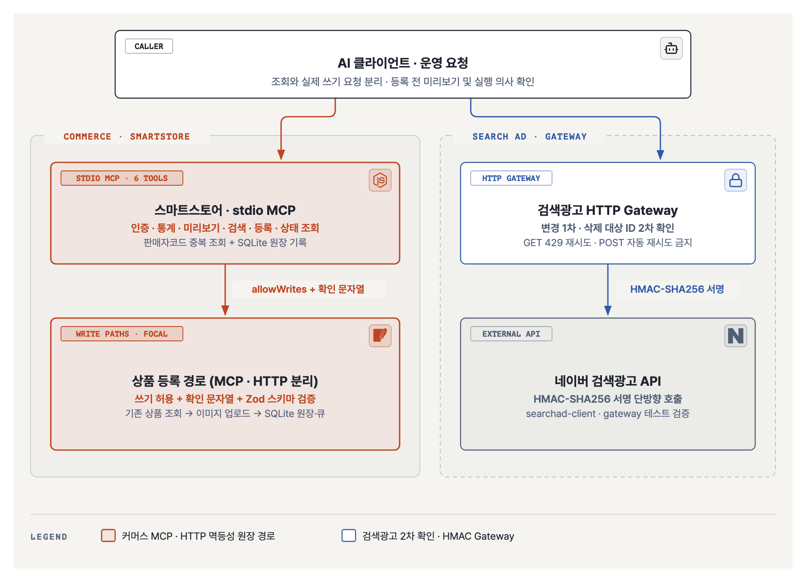
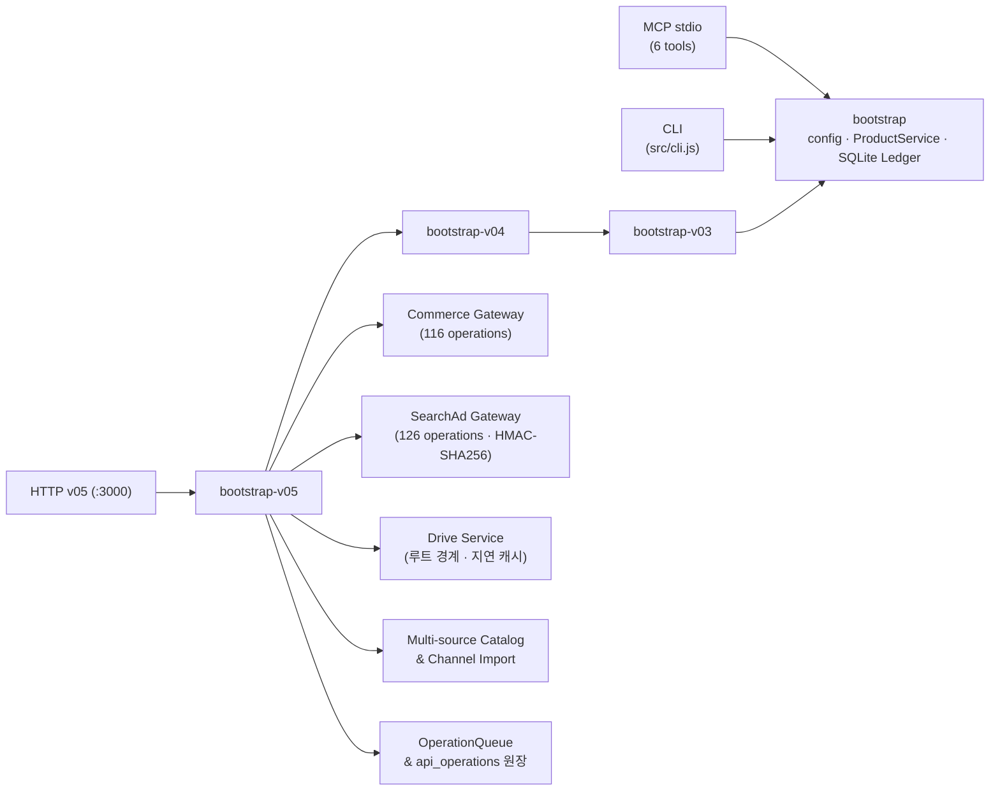
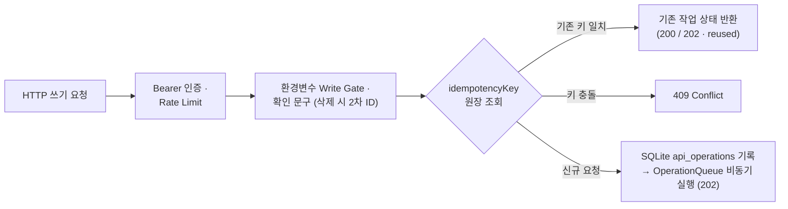

# AtelierPopo

직접 운영하는 쇼핑몰의 **네이버 스마트스토어(커머스 API)**, **네이버 검색광고(SearchAd)**, **Google Drive 카탈로그**를 하나의 Node.js 브리지로 통합해 MCP · HTTP · CLI로 제공하는 프로젝트입니다. (`v0.6.0`, Apache-2.0)

## 주요 기능

- **스마트스토어 MCP 서버 (`stdio`, 6개 도구)**: AI 클라이언트에 넓은 쓰기 권한을 주지 않기 위해 인증 확인, 카탈로그 통계, 상품 미리보기, 원격 상품 검색, 상품 등록, 원장 조회 6개 도구만 노출합니다.
- **스펙 기반 커머스 · 검색광고 Gateway**: 공식 API 스펙 manifest에서 커머스 116개(8개 도메인), 검색광고 126개(117개 runtime allowlist, 9개 tier D 차단) operation을 읽어 게이트와 확인 절차를 적용합니다.
- **다층 쓰기 게이트 · 비동기 작업 큐**: 기본 상태는 쓰기 금지(`false`)이며, HTTP 쓰기 요청은 Bearer 인증, rate limit, operation gate, 확인 문구(파괴적 작업은 대상 ID 2차 확인), `idempotencyKey`를 통과한 뒤 SQLite 원장(`api_operations`)과 `OperationQueue`로 처리됩니다.
- **Google Drive 경계 · 채널 카탈로그 동기화**: 허용 루트 폴더 밖 접근을 차단하고 필요한 상품 파일만 지연 캐시합니다. Naver/Cafe24 읽기 전용 importer는 `(source_id, source_product_id)` 식별자와 checkpoint 기반 재개를 지원합니다.

## 프로젝트 구조

| 경로 | 설명 |
|---|---|
| `smartstore-bridge/` | 핵심 Node.js 브리지 (MCP stdio, HTTP v05, CLI, Commerce/SearchAd Gateway, Drive, 다중 공급처 카탈로그, SQLite 원장, PostgreSQL 마이그레이션) |
| `frontend/` | Next.js 15 / React 19 정적 스토어프론트 프로토타입 (브리지 미연동) |
| `.github/workflows/` | 다중 공급처 카탈로그 · 채널 가져오기 CI |

## 아키텍처



### 런타임 조립 구조



- **MCP / CLI**: `bootstrap`만 로드해 `ProductService.create()`를 직접 호출하고 `product_jobs` 원장과 판매자관리코드 중복 조회를 사용합니다.
- **HTTP v05**: `bootstrap-v05 → v04 → v03 → base` 순으로 전체 도메인을 조립하며, 쓰기 요청을 비동기 큐(`202 Accepted`)와 `/api/v1/operations/{id}` 폴링으로 처리합니다.

### 쓰기 경로 및 안전 경계



| 경로 | 인증 · 게이트 | 원장 · 실행 방식 |
|---|---|---|
| **HTTP v05 비동기 쓰기** | Bearer API Key + Rate Limit + Operation Gate + 확인 문구(+ 2차 ID) + `idempotencyKey` | SQLite `api_operations` + `OperationQueue` (`202` 반환 후 폴링) |
| **MCP `atelier_create_product`** | `NAVER_ALLOW_WRITES=true` + `writeConfirmation` | SQLite `product_jobs` + 판매자관리코드 중복 조회 |
| **CLI `product create --execute`** | `NAVER_ALLOW_WRITES=true` + `writeConfirmation` | SQLite `product_jobs` + 판매자관리코드 중복 조회 |

## 주요 설계 결정

1. **MCP 표면 최소화**: 에이전트가 임의 API를 호출하지 못하도록 MCP는 6개 핵심 도구로 좁히고, 전체 operation 제어는 게이트가 붙은 HTTP v05로 분리했습니다.
2. **Manifest 기반 Allowlist**: 엔드포인트를 코드에 흩뿌리지 않고 `specs/naver-commerce/current.json`, `specs/naver-searchad/current.json`에서 operation 목록과 위험 등급(tier)을 읽습니다. tier D 9개는 `runtimeAllowlisted: false`로 고정 차단합니다.
3. **Fail-Closed 쓰기 게이트 · 재시도 분리**: 모든 쓰기 플래그 기본값은 `false`이며, SearchAd 클라이언트는 조회(`GET`) 429만 백오프 재시도하고 변경(`POST`)은 중복 실행을 막기 위해 기본 자동 재시도를 제외했습니다.
4. **고객 단위 SearchAd 자격증명**: `principal(access license + secret) → grant → customer` 구조로 한 고객에 단일 principal만 허용해 서명 주체를 명확히 고정했습니다(응답에 secret key는 노출하지 않음).
5. **Drive 루트 경계 · 지연 캐시**: 허용된 루트 폴더 밖의 파일 조작을 차단하고, 전체 카탈로그를 미리 복제하지 않고 필요한 파일만 로컬 캐시에 materialize합니다.

## 코드 가이드

| 영역 | 파일 |
|---|---|
| MCP 엔트리 · 6개 도구 계약 | `smartstore-bridge/src/mcp.js`, `smartstore-bridge/src/mcp/tools.js` |
| 커머스 Operation Gateway | `smartstore-bridge/src/naver/commerce/gateway.js` |
| SearchAd 서명 · Gateway | `smartstore-bridge/src/naver/searchad/auth.js`, `smartstore-bridge/src/naver/searchad/gateway.js` |
| HTTP v05 라우트 · 공통 멱등성 헬퍼 | `smartstore-bridge/src/http/server-v05.js`, `smartstore-bridge/src/http/runtime.js` |
| 비동기 큐 · SQLite 원장 | `smartstore-bridge/src/application/operation-queue.js`, `smartstore-bridge/src/infrastructure/ledger.js` |
| Drive 루트 경계 · 채널 Importer | `smartstore-bridge/src/drive/boundary.js`, `smartstore-bridge/src/catalog/channel-import/import-service.js` |
| MCP 계약 · 핸들러 테스트 | `smartstore-bridge/test/mcp-contract.test.js`, `smartstore-bridge/test/mcp-tools.test.js` |
| HTTP 보안 · SearchAd 재시도/게이트 테스트 | `smartstore-bridge/test/http-security-config.test.js`, `smartstore-bridge/test/searchad-client.test.js`, `smartstore-bridge/test/searchad-gateway-capability.test.js` |
| 로컬 데모 Fixture | `smartstore-bridge/examples/local-demo/catalog/catalog_manifest.json` |

## 실행 및 테스트

```bash
# 의존성 설치, 테스트 및 구문 검사
cd smartstore-bridge
npm ci
npm test
npm run check
```

```bash
# MCP stdio 서버 실행
npm run mcp

# MCP Inspector 실행 (선택)
npm run inspect:mcp

# HTTP v05 서버 실행 (기본 포트 3000, 읽기 전용)
npm start
```

```bash
# 프론트엔드 프로토타입 실행 (저장소 루트 기준)
cd frontend
npm ci
npm run dev
# 브리지가 3000 포트를 사용 중이면: npm run dev -- -p 3001
```

- 외부 API 키 없이 로컬 fixture 카탈로그로 HTTP 읽기 경로를 확인하려면 [`smartstore-bridge/examples/local-demo/README.md`](smartstore-bridge/examples/local-demo/README.md)의 환경변수로 실행하면 됩니다.
- PostgreSQL 통합 테스트는 `TEST_DATABASE_URL`이 설정된 경우에만 실행됩니다(미설정 시 자동 skip).

### MCP 클라이언트 설정 예시

별도 설정 파일을 쓰려면 `config/atelier-popo.example.json`을 `config/atelier-popo.json`으로 복사한 뒤 경로를 맞춰 등록합니다.

```json
{
  "mcpServers": {
    "atelier-popo-smartstore": {
      "command": "node",
      "args": ["/path/to/AtelierPopo/smartstore-bridge/src/mcp.js"],
      "env": {
        "ATELIER_POPO_CONFIG": "/path/to/AtelierPopo/smartstore-bridge/config/atelier-popo.json"
      }
    }
  }
}
```

## 현재 한계 및 참고 사항

- **인증 범위**: HTTP API는 공유 Bearer 키 방식이며, 사용자별 권한 격리(RBAC)는 구현되어 있지 않습니다.
- **멱등성 범위**: SQLite `idempotency_key`로 중복 operation 기록을 차단하지만, 원격 외부 API 호출의 exactly-once를 보장하지는 않습니다. 프로세스 비정상 종료 시 `interrupted` 상태는 수동으로 재확인해야 합니다.
- **테스트 범위**: 자동화 테스트는 fixture/mock 기반이며, `frontend/`는 브리지 미연동 정적 프로토타입입니다.
- **이전 버전 코드**: `v03`/`v04` 엔트리포인트는 호환 및 이력 참고용으로 남아 있으며, 현재 기준은 `v05`입니다.

## 문서

- [`smartstore-bridge/README.md`](smartstore-bridge/README.md)
- [`smartstore-bridge/examples/local-demo/README.md`](smartstore-bridge/examples/local-demo/README.md)
- [`smartstore-bridge/docs/ARCHITECTURE.md`](smartstore-bridge/docs/ARCHITECTURE.md)
- [`smartstore-bridge/docs/NAVER_SEARCHAD_CURRENT.md`](smartstore-bridge/docs/NAVER_SEARCHAD_CURRENT.md)
- [`smartstore-bridge/docs/MULTI_SOURCE_PRODUCT_ARCHITECTURE.md`](smartstore-bridge/docs/MULTI_SOURCE_PRODUCT_ARCHITECTURE.md)
- [`smartstore-bridge/.env.example`](smartstore-bridge/.env.example)

## License

Apache-2.0. See [`LICENSE`](LICENSE).
